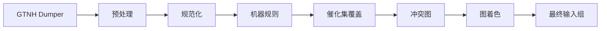

# GTNH-Recipe-Check


面向 **GTNH（GregTech: New Horizons）** 的配方检查工具。读取 GTNH Dumper 导出，完成配方清洗、冲突检测与催化组合并，当前生成适用于**发配方式 1** 的催化组划分方案。

> **当前仅实现发配方式 1，方式 2、3 尚未实现。** 欢迎提交 Issue 或 Pull Request 反馈问题、补充机器规则或参与开发。

## 发配方式

| 方式 | 缓存与发配规则 | 状态 |
|---|---|---|
| **方式 1** | 每个催化组使用独立缓存；同一个缓存空间同一时间只允许触发一个配方。 | 已实现 |
| **方式 2** | 每个催化组使用独立缓存；组内全部配方可同时发配，但流体种类数受限。 | 未实现 |
| **方式 3** | 多个催化组共用流体缓存，物品缓存相互独立；每组独立发配，同一时间每组只存在一个配方，流体种类数受限。 | 未实现 |

三种方式的关键差异是缓存是否共享、组内配方能否并发，以及是否限制流体种类数。方式 2、3 的冲突判定不能直接沿用方式 1；若计划实现，主要开发工作应集中在 [`s5_conflict/`](s5_conflict/) 的 `conflict` 阶段，按新的缓存与发配规则调整串配方判定和冲突图构建。`color` 阶段的着色与合并流程原则上可以复用。

[快速开始](#快速开始) · [常用命令](#常用命令) · [配置](#配置) · [输出产物](#输出产物) · [工作原理](#工作原理)

## 快速开始

### 环境要求

- Python 3.9+
- 无需安装第三方依赖
- 一份 GTNH Dumper 导出数据

### 1. 获取项目

```bash
git clone https://github.com/GTNH-Huijiwiki/GTNH-Recipe-Check.git
cd GTNH-Recipe-Check
```

如果项目已经存在于本地，可跳过这一步。

### 2. 准备 Dumper 数据

将 GTNH Dumper 的导出文件放到任意目录，例如：

```text
Raw/2.9.0/
├── advitempanel.json
├── oreDictionary.json
├── fluid.json
└── recipes/
    └── gregtech/
        └── GTNEIDefaultHandler_assembler.json
```

`recipes/` 支持多级目录，程序会自动扫描其中名为 `GTNEIDefaultHandler_<机器>.json` 的配方文件。

### 3. 修改配置

打开 [`config.py`](config.py)，确认数据目录：

```python
DUMPER_DIR = Path("./Raw/2.9.0")
DATA_SPLIT_DIR = Path("./Data/2.9.0")
```

`DUMPER_DIR` 是 Dumper 导出目录，`DATA_SPLIT_DIR` 是预处理产物目录。输出版本名默认取 `DATA_SPLIT_DIR.name`。

需要处理的机器由 `INTERESTED_MACHINES` 白名单控制；只保留自己需要的机器可以减少运行时间。

### 4. 运行

首次运行，或希望从 Dumper 原始数据完整重跑：

```bash
python main.py --stage all
```

如果已经生成过 `Data/<版本>/`，日常只需重新计算后续阶段：

```bash
python main.py
```

### 5. 查看结果

运行完成后，结果位于 `Output/<版本>/`。通常先查看：

- `conflict_graph/conflicts.md`：人类可读的冲突报告
- `input_groups/machines/<机器>/input_groups.json`：最终催化组方案
- `recipe_check.log`：完整运行日志、警告与异常信息

默认冲突报告只列出冲突配方对少于 3 的节点关系。需要完整报告时运行：

```bash
python main.py --stage conflict --conflict-report
```

## 常用命令

| 使用场景 | 命令 |
|---|---|
| 从 Dumper 原始数据完整执行 | `python main.py --stage all` |
| 已有 `Data/`，执行默认链路 | `python main.py` |
| 只执行预处理 | `python main.py --stage preprocess` |
| 只执行规范化 | `python main.py --stage normalize` |
| 只执行机器规则 | `python main.py --stage rules` |
| 只执行催化集覆盖分析 | `python main.py --stage cover` |
| 只构建冲突图 | `python main.py --stage conflict` |
| 只执行图着色与最终翻译 | `python main.py --stage color` |
| 跳过机器规则并保留对照结果 | `python main.py --no-rules` |
| 从原始数据执行完整无规则链路 | `python main.py --stage all --no-rules` |
| 生成完整冲突报告 | `python main.py --stage conflict --conflict-report` |
| 不生成人类可读冲突报告 | `python main.py --stage conflict --no-conflict-report` |
| 查看所有参数 | `python main.py --help` |

完整阶段顺序为：

```text
preprocess → normalize → rules → cover → conflict → color
```

不传 `--stage` 时从 `normalize` 开始；单阶段命令**不会自动补齐前置阶段**，请确保所依赖的上游产物已经存在。

`--no-rules` 的产物写入 `Output/<版本>-no-rules/`，不会覆盖正式结果。

## 配置

常用配置都在 [`config.py`](config.py)：

| 配置项 | 作用 |
|---|---|
| `DUMPER_DIR` | GTNH Dumper 导出目录，预处理阶段的输入 |
| `DATA_SPLIT_DIR` | 预处理产物目录，同时也是后续阶段的数据源 |
| `INTERESTED_MACHINES` | 需要处理的机器白名单 |
| `OUTPUT_ROOT` | 输出根目录，默认 `Output/` |
| `CONFLICT_REPORT_PAIR_THRESHOLD` | 默认冲突报告的配方对筛选阈值 |
| `COLORING_ROUNDS` | 每档着色搜索的随机探索轮数；越大越慢，也更可能找到更优方案 |
| `COLOR_CLASS_SIZE_SWEEP_MAX` | 着色搜索的最大单色类节点数档位 |

大多数使用场景只需要修改前两项，并视需要调整机器白名单。

新增机器时，确保：

1. 机器名已加入 `INTERESTED_MACHINES`。
2. `Data/<版本>/Recipes/` 中存在对应的 `GTNEIDefaultHandler_<机器>.json`。
3. 如需机器专属删减规则，在 [`s3_rules/`](s3_rules/) 中实现，并在 [`registry.py`](s3_rules/registry.py) 注册。

未注册规则的机器会按默认逻辑保留配方。

## 输出产物

每次运行会在 `Output/<版本>/` 下生成阶段化产物：

```text
Output/<版本>/
├── recipe_check.log
├── normalized_recipes/
├── selected_recipes/
├── catalyst_pick/
├── conflict_graph/
│   ├── conflicts.md
│   └── machines/<机器>/graph.json
└── input_groups/
    └── machines/<机器>/input_groups.json
```

| 路径 | 内容 |
|---|---|
| `recipe_check.log` | 运行日志、警告、错误与异常堆栈 |
| `normalized_recipes/` | 规范化后的输入、输出与催化条件 |
| `selected_recipes/` | 应用机器规则后的配方 |
| `catalyst_pick/` | 催化集关系与最小覆盖结果 |
| `conflict_graph/` | 各机器的冲突图与人类可读报告 |
| `input_groups/` | 最终输入组、催化组、展示标签与配方覆盖数 |

各阶段目录下都有 `manifest.json`，用于记录上游输入和产物哈希。

如果需要逐条检查机器规则的影响，建议将 `--no-rules` 的结果与正式结果对照：

```text
Output/<版本>/selected_recipes/
Output/<版本>-no-rules/selected_recipes/
```

## 工作原理



**串配方**：同一催化组的缓存空间可以同时满足两个非等效配方的触发条件时，其中一个配方可能被提前触发。

工具会找出这类配方对并构建冲突图：冲突的催化组不能合并；不冲突的催化组可以共用同一缓存。图着色用于在满足约束的前提下减少最终催化组数量。

| 阶段 | 作用 |
|---|---|
| `preprocess` | 将 Dumper 原始数据整理为 `Items.json`、`OreDictionary.json` 和 `Recipes/` |
| `normalize` | 展开输入条件、合并等效配方、统一催化条件 |
| `rules` | 应用机器专属规则，删除不适合自动发配的配方 |
| `cover` | 合并等价催化集，求取更小的催化集覆盖 |
| `conflict` | 检查串配方并构建无向冲突图 |
| `color` | 为冲突图着色，将同色催化组合并为最终方案 |

机器规则属于**有损筛选**，删掉的配方不会参与后续分析，建议人工复核。希望完全跳过规则时使用 `--no-rules`。

跨阶段字段与数据结构见 [`s0_contracts/DATA_CONTRACTS.md`](s0_contracts/DATA_CONTRACTS.md)。
