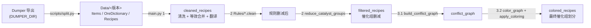

# GTNH-Recipe-Check · 配方冲突检查与催化组划分

面向 **GTNH**（GregTech: New Horizons）的配方自动化工具：以 GTNH Dumper 导出为输入，完成**配方清洗 → 等效合并 → 规则删减 → 催化组删减 → 冲突图着色**，最终产出一组在**发配方式 1**（每个催化组独立缓存、同时只跑一个配方）下互不「串配方」的催化组划分方案。

- 纯标准库实现，无第三方依赖，Python 3.9+。
- 内部判决一律以物品/流体的 `key` 为身份；`originalName` 只用于规则匹配，`translatedName` 只用于展示。

---

## 目录

- [目录结构](#目录结构)
- [快速开始：split 与 main 的分工](#快速开始split-与-main-的分工)
- [main.py 参数](#mainpy-参数)
- [config.py 参数](#configpy-参数)
- [数据流](#数据流)
- [输出产物](#输出产物)
- [机器专属规则（Rules/）](#机器专属规则rules)
- [复核工具](#复核工具)
- [术语定义](#术语定义)
- [方案流程](#方案流程)
- [常见问题](#常见问题)

---

## 目录结构

```
GTNH-Recipe-Check/
├── main.py                       # 主流程入口（1 清洗 → 2 删减 → 3 冲突图/着色）
├── config.py                     # 集中配置（数据目录、机器白名单、输出与着色参数）
├── check_recipe_conflict.py      # CLI：按两个 recipeId 复核是否串配方
├── manual_check.py               # CLI：手动输入催化组方案，检查组内串配方
├── README.md
├── Core/                         # 通用核心逻辑（库，与具体机器无关）
│   ├── data_loader.py            # 读取机器配方 / 物品翻译 / 矿辞典
│   ├── recipe_cleaner.py         # 1：展开输入可选列表、拆催化剂与电路、合并等效配方
│   ├── ore_dictionary.py         # 1：# 矿辞典与 :32767 通配展开（同名折叠为虚拟 key）
│   ├── virtual_key.py            # 虚拟 key 的生成 / 识别 / 还原（同名不同 key 归一身份）
│   ├── translator.py             # 1：key → originalName / translatedName（保留 key）
│   ├── catalyst_reducer.py       # 2：按覆盖关系删减催化组（等价类 → 抽象催化剂）
│   ├── recipe_checker.py         # 3：签名、串配方方向判定、冲突图构建、可读标签
│   ├── graph_coloring.py         # 3：多轮随机化 DSATUR 贪心着色 + 催化组合并
│   ├── manual_conflict_checker.py # manual_check.py 的解析 / 判定 / 报告核心
│   └── logger.py                 # 日志配置与问题计数
├── Rules/                        # 机器专属规则（在 2、催化组删减之前执行）
│   ├── registry.py               # 机器名 → cleaner 注册表
│   ├── assembler.py              # 组装机
│   ├── fluidchemicaleactor.py    # 流体化学反应器
│   └── laserengraver.py          # 激光蚀刻机
├── scripts/
│   └── split.py                  # 数据准备：Dumper 导出 → Data/<版本>/
├── profiling/                    # 性能 / 一致性验证脚本（本地辅助，不入库）
│   ├── benchmark_scale.py        # 多规模耗时测量（复杂度阶数）
│   ├── build_conflict_profile.py # 3.1 建图 cProfile 分析
│   └── verify_optimization.py    # 快速判定与原始 Counter 判定的一致性验证
├── Data/                         # split.py 的产物，main.py 的输入
└── Output/                       # main.py 的产物（见「输出产物」）
```

**各层职责**：`Core/` 是可复用的库（不含机器与配置依赖）；`Rules/` 只放机器专属规则；`scripts/` 放一次性数据处理脚本；根目录只保留入口（`main.py` / `config.py` / 两个复核 CLI）。

> 版本控制只保留最小功能集：`Core/`、`Rules/`、`scripts/`、`main.py`、`config.py`、两个复核 CLI、`README.md`；`Data/`、`Output/`、`profiling/`、`experiments/`、`.vscode/` 均不入库，见 `.gitignore`。

---

## 快速开始：split 与 main 的分工

两个入口职责完全不同，**绝大多数时候只需要跑 `main.py`**。

| | `scripts/split.py` | `main.py` |
|---|---|---|
| 作用 | 把 Dumper 原始导出整理成统一格式的数据集 | 把数据集变成催化组划分方案 |
| 输入 | `config.DUMPER_DIR`（Dumper 导出的原始目录） | `config.DATA_DIR`（= `config.DATA_SPLIT_DIR`） |
| 输出 | `Data/<版本>/`：`Items.json`、`OreDictionary.json`、`Recipes/` 等 | `Output/`：清洗 / 过滤 / 着色产物与日志 |
| 何时跑 | **数据源更新时**：换了 GTNH 版本、重新导出、新增模组 | **改规则 / 改配置 / 想看新方案时**（每次分析都跑） |
| 耗时 | 分钟级（全量解析 Dumper 导出） | 视机器与配方量而定，支持增量复用 |

### 什么时候跑 split

只有当你手上有了**新的 Dumper 导出**时才需要：

```bash
python scripts/split.py                # items + oredict + recipes（同一进程内依次执行）
python scripts/split.py items          # 仅 Items
python scripts/split.py oredict        # 仅 OreDictionary
python scripts/split.py recipes        # 仅 Recipes（独立运行无法做 NBT key 解析，见下）
python scripts/split.py items recipes  # 多个子步骤（items 必须先于 recipes）
```

- `items` 必须先于 `recipes`：Recipes 的 NBT key 解析依赖完整 item 信息（`rawKey`/`nbt`），落盘的 `Items.json` 只保留三列，故只有同一进程内先执行过 `items` 才能解析。
- 产物目录由 `config.DATA_SPLIT_DIR` 指定；换版本时改这里即可（`main.py` 会自动跟随，因为 `DATA_DIR = DATA_SPLIT_DIR`）。

#### DUMPER_DIR 需要包含的文件

`scripts/split.py` 只读以下四项（均为 `DUMPER_DIR` 下的相对路径，由 GTNH Dumper 导出）：

| 路径 | 顶层结构 | 用途 |
|---|---|---|
| `advitempanel.json` | `{"shortKey": [ ... ]}` | 物品/流体注册表，生成 `Items.json`；同时用其 `rawKey`/`nbt` 做 NBT key 修正与退行 |
| `oreDictionary.json` | `{"oreDictionaries": [{"oreDict": 名称, "items": [key, ...]}, ...]}` | 矿辞典，生成 `OreDictionary.json` |
| `fluid.json` | `{"fluids": [{"gtDisplayKey": ..., "key": ...}, ...]}` | 把流体物品的 key 改写为真实流体 key |
| `recipes/` | 目录树，任意层级的 `*.json` | 每台机器一份配方（如 `recipes/gregtech/GTNEIDefaultHandler_assembler.json`），输出为 `Recipes/<相对路径>` |

- 各子步骤的必需输入：`advitempanel.json` → `items`，`oreDictionary.json` → `oredict`，`recipes/` → `recipes`；此外 `fluid.json` 供 `items` 改写流体 key，`recipes/` 也供 `items` 做 NBT 退行扫描（缺失时提示并跳过）。
- `recipes/` 下的目录名会被原样保留（`Recipes/<来源mod>/<处理器>.json`），因此 `config.RECIPE_SOURCE_DIRS` 与 `INTERESTED_MACHINES` 必须与这些目录名/文件名匹配。
- `nbt_regress_cache.json`、`nbt_missing.csv` 是 split 的**产物**（写在 `DATA_SPLIT_DIR`），不需要预先存在。

### 什么时候跑 main

```bash
python main.py             # 增量：已有产物直接复用，仅重算缺失/受影响的机器
python main.py --rebuild   # 强制重算 1 清洗与 2 删减
```

选择依据：

| 你改了什么 | 命令 |
|---|---|
| `Rules/*.py`（机器规则）、`Core/recipe_cleaner.py`、`Core/ore_dictionary.py`、翻译/清洗逻辑 | `python main.py --rebuild`（否则会复用旧的清洗产物） |
| `config.INTERESTED_MACHINES` 新增机器 | `python main.py`（新机器无产物，会自动重算） |
| `COLORING_ROUNDS` / `COLOR_CLASS_MAX_SIZE`，或只想换一版着色方案 | `python main.py`（3 每次都会重跑，只保留历史最优） |
| 数据本身（先跑过 `split.py`） | `python main.py --rebuild` |

> 3（冲突图与着色）每次运行都会重算，但**跨次运行只保留最优方案**（图未变时若历史更优则沿用）；1/2 默认复用 `Output/` 中已有产物。聚合文件（`index.json` / `catalyst_reduction.json` / `conflict_graph.json` / `coloring.json`）按机器**合并更新**：剔除本次机器的旧条目后追加新条目，未列入白名单的机器旧产物不受影响。

---

## main.py 参数

| 参数 | 说明 |
|---|---|
| `--rebuild` | 强制重新生成 1（清洗/翻译）与 2（规则删减/催化组删减），忽略已有产物。不加则复用已有清洗与过滤文件。 |

除 `--rebuild` 外没有其它命令行参数，其余行为全部由 `config.py` 控制。

---

## config.py 参数

| 配置项 | 说明 | 当前值 |
|---|---|---|
| `DUMPER_DIR` | GTNH Dumper 导出的原始数据目录，`scripts/split.py` 的输入（需包含的文件见上节「DUMPER_DIR 需要包含的文件」） | 见文件内绝对路径 |
| `DATA_SPLIT_DIR` | split 的输出目录，即数据集根目录 | `./Data/2.9.0-beta-3` |
| `DATA_DIR` | `main.py` 读取的数据根目录，默认等于 `DATA_SPLIT_DIR` | `= DATA_SPLIT_DIR` |
| `INTERESTED_MACHINES` | 本次要处理的机器白名单（可填多台）。机器名 = 导出文件名去掉 `GTNEIDefaultHandler_` 前缀与 `.json` 后缀 | `{"fluidchemicaleactor"}` |
| `RECIPE_SOURCE_DIRS` | 在 `Recipes/` 下搜索机器的来源 mod 目录；同一机器名出现在多个来源时按来源分别输出（文件名加 `__来源` 后缀） | `("gregtech", "miscutils")` |
| `OUTPUT_ROOT` | 输出根目录 | `Output` |
| `LOG_FILE` | 运行日志路径 | `Output/recipe_check.log` |
| `CLEANED_RECIPES_DIR` | 1 清洗产物目录 | `Output/cleaned_recipes` |
| `FILTERED_RECIPES_DIR` | 2 过滤产物目录 | `Output/filtered_recipes` |
| `COLORED_RECIPES_DIR` | 3 着色产物目录 | `Output/colored_recipes` |
| `COLORING_ROUNDS` | 冲突图着色的随机探索轮数，越大越可能找到更优解 | `128` |
| `COLOR_CLASS_MAX_SIZE` | 单个颜色类允许的最大节点数；`None` 表示不限制 | `None` |

白名单中的机器若在所有来源目录都找不到，程序会**报错停止**（不会静默产出空结果）。

另有位于 `Core/ore_dictionary.py` 的开关 `EXPAND_WILDCARD_32767`（不放在 config）：控制 `:32767` 通配 meta 是否展开为具体 key。

---

## 数据流



---

## 输出产物

| 路径 | 内容 |
|---|---|
| `Output/recipe_check.log` | 运行日志（映射失败、自冲突、问题计数等） |
| `Output/cleaned_recipes/{machine}.json` | 清洗 + 等效合并 + 翻译后的配方（保留 `key`） |
| `Output/cleaned_recipes/index.json` | 已清洗机器索引（跨次运行合并） |
| `Output/filtered_recipes/{machine}.json` | 规则删减 + 催化组删减后的配方（含 `recipeId`） |
| `Output/filtered_recipes/index.json` | 已过滤机器索引 |
| `Output/filtered_recipes/catalyst_reduction.json` | 催化组删减元数据（关系分量、顶层候选、等价组、抽象催化剂） |
| `Output/filtered_recipes/conflict_graph.json` | 各机器冲突图（节点、邻接矩阵；仅下三角非零） |
| `Output/colored_recipes/{machine}.json` | 着色后配方（催化组已替换为合并后的颜色组） |
| `Output/colored_recipes/coloring.json` | 着色方案汇总（最优轮次 `best_round`、颜色、节点归属、合并后催化组） |

---

## 机器专属规则（Rules/）

`Rules/*.py` 提供 `clean(recipes) -> recipes`，在 2 阶段、**催化组删减之前**执行，因此看到的是「等效合并后、尚未做子集拆分/抽象替换」的原始催化组列表。

已注册规则：

- `assembler.py`（组装机）：删除输入仅为 `Capacity Bottle` / `Memory Bus` / `Volumetric Flask` 的配方；按目标催化组删除或裁剪分组；删除「催化组含编程电路 24 且输出物品全为 Cable」的配方。
- `fluidchemicaleactor.py`（流体化学反应器）：把每个催化组的催化剂部分置空，只保留编程电路。
- `laserengraver.py`（激光蚀刻机）：删除若干特定输入/输出形状的配方。

新增机器规则：在 `Rules/` 下新建 `<机器>.py` 实现 `clean`，并在 `Rules/registry.py` 的 `_MACHINE_CLEANERS` 中注册。未注册的机器使用默认 cleaner（原样返回）。

---

## 复核工具

```bash
# 按两个 recipeId 判断是否构成串配方
python check_recipe_conflict.py <machine> <recipeId_A> <recipeId_B>

# 手动输入催化组方案，检查方案内各组是否串配方（默认示例对应 laserengraver）
python manual_check.py
python manual_check.py "{[Ruby Lens],[]},{[Sapphire Lens],[]}"
```

两者均在工作目录为仓库根时使用（`check_recipe_conflict.py` 读取 `Output/filtered_recipes/`）。

---

## 术语定义

### 输入与输出
- **输入**：由 `[物品, 数量]` 列表和 `[流体, 数量]` 列表共同构成。
- **输出**：同样由 `[物品, 数量]` 列表和 `[流体, 数量]` 列表共同构成。
- 输入和输出均不能为空。

### 催化组
- **催化组**：由 `催化剂` 列表和 `编程电路` 两部分组成。
- 催化剂列表可以为空，编程电路可以为空，二者可以同时为空。

### 配方
- **配方**：`输入 + 催化组 -> 输出`。
- 每个配方中的催化组中，编程电路数量不超过 1，催化剂种类不限。

### 等效配方
- **等效配方**：`输入` 和 `输出` 在种类和数量上完全相同的 N（N>0）个配方（催化组可不同）。

### 组内配方
- **组内配方**：在给定催化组 $G$ 的条件下能够被触发的全部等效配方的并集。
- 若 $G$ 包含多个催化剂，需考虑 $G$ 的**任意非空子集**作为实际起作用的催化条件，取并集：

$$ Recipes(G) = \bigcup_{\emptyset \neq S \subseteq G} Recipes(S) $$

### 串配方
- **串配方**：给定催化组 $G$ 及其缓存空间，若缓存空间中的物品、流体能够同时满足两个非等效配方的触发条件，则称这两个配方在该催化组下构成串配方。
- 典型场景：
  1. 某个配方需要消耗另一个配方所需的催化剂，导致催化剂被反应掉；
  2. 缓存空间内存在的同一输入被多个可能的催化组反应为不同输出；
  3. 缓存空间内存在的不同输入被多个可能的催化组反应为不同输出。

### 发配方式
- **方式 1**：每个催化组使用独立缓存空间，同一空间内同一时间只允许存在一个配方。
- **方式 2**：每个催化组独立缓存，同时进行全部组内配方发配，但流体种类数受限。
- **方式 3**：多个催化组共用流体缓存、物品缓存独立；每组独立发配，同一时间各自只存在一个配方，流体种类数受限。

本项目只针对**方式 1**。

---

## 方案流程

### 0. 数据准备（scripts/split.py）
把 Dumper 导出整理为 `Data/<版本>/`：`Items.json`（`key`/`originalName`/`translatedName`）、`OreDictionary.json`（`{矿辞典名: [key...]}`）、`Recipes/<来源>/GTNEIDefaultHandler_<机器>.json`。

### 1. 清洗与翻译

- 只处理 `INTERESTED_MACHINES` 白名单内的机器；已有清洗产物且未 `--rebuild` 时直接复用。
- **输入可选列表展开**：`inputItems`/`outputItems` 中同一项的多个可选对象按笛卡尔积展开为多条配方。
- **拆分催化条件**：带 `nc` 标记的输入项按是否为编程电路，分别归入催化组的 `circuit` / `catalysts`。
- **矿辞典与通配展开**（`Core/ore_dictionary.py`）：
  - `#矿辞典名` → 查 `OreDictionary.json` 展开为全部成员；
  - `:32767` 结尾的通配 meta → 取注册表中同前缀的全部 `key`（受 `EXPAND_WILDCARD_32767` 控制，当前为 `True`）。
  - **同名折叠**：若一次展开得到的多个 `key` 其 `(originalName, translatedName)` 完全相同，则折叠为**单个虚拟 key**（`Core/virtual_key.py`），展开退化为「key 替换」，不产生多份等价配方。
- **等效合并**：输入（物品+流体）与输出（物品+流体）完全相同的配方合并，其催化组合并去重。
- **翻译**：为物品/流体补充 `originalName` / `translatedName`，**保留 `key` 作为唯一身份键**（映射失败记入日志）。

### 2. 删减

- **规则删减（有损，需人工确认）**：按 `Rules/*.py` 删除部分配方；删减后的集合即视为新的「全配方」，不再覆盖被删除的配方。
- **催化组删减（自动、无损）**：对全配方中出现的所有催化组 $G$ 计算 $Recipes(G)$，定义关系：
  - **包含**：$Recipes(A) \supseteq Recipes(B)$；
  - **等价**：$Recipes(A) = Recipes(B)$；
  - **相交**：交集非空且既非包含也非等价。
  将存在上述关系的催化组归入同一**关系分量**；对每个分量取顶层催化组作为候选（等价类用**抽象催化剂**取代，并在 `catalyst_reduction.json` 记录还原信息），再贪心选取覆盖全部配方的候选集合。

> 交叉关系的选择可能不唯一，程序只给出其中一个方案。

### 3. 冲突图与着色

1. **构建冲突图**（`build_conflict_graph`）：
   - 节点 = 候选催化组（按 `group_signature` 去重）；边 = 会被同一缓存同时触发、且构成串配方的两组。
   - **方向判定**：对两个配方（及其各自催化组）分别检查 `左→右`、`右→左`。以 `key` 为身份、忽略数量。
     因为催化剂/电路属于独立类型、不会替代材料输入，判定可化简为材料输入集合的包含关系：
     `左→右 ⇔ 输入(右) ⊆ 输入(左)`，`右→左` 对称。
   - **输出相等豁免**：若两配方输出（物品+流体，忽略数量）**完全相同**，则即使输入构成包含也视为良性连带，不判为串配方（不记自冲突、不连边）。
   - **自冲突**：落在同一催化组内、且构成串配方的非等效配方对，记入日志（无法靠分组解决）。
2. **着色**（`color_graph` + `apply_coloring`）：
   - 相邻节点必须不同色（即冲突的催化组不能共处同一缓存）；
   - 同色节点合并为一个新催化组；
   - 目标：**催化组数（颜色数）最少**；并列时，单个催化组覆盖的配方数最大值尽量小。
   - 探索方式：选点按 DSATUR（饱和度、度数，随机打破平局）；取色以最小可用色为主，并按概率随机偏离去，解决「各轮目标值完全相同」的探索性不足（`Core/graph_coloring.py` 的 `_COLOR_EXPLORE_PROB` / `_MAX_COLOR_CHOICES`）。
   - 多轮随机探索后**只保留并输出最优一轮**（`coloring.json` 中的 `best_round` 记录其轮号）。
   - **跨次运行也只保留最优**：`graph_fingerprint` 一致（冲突图未变）且历史方案不差时，沿用历史结果并重新套用到当前配方。
   - 合并后的催化组可含多个编程电路，标签展示时按编号升序，无编号的「编程电路0」排最前。

---

## 常见问题

- **改了 `Rules/` 但结果没变**：1/2 默认复用已有产物，需要 `python main.py --rebuild`。
- **只想更新部分机器**：把目标机器放入白名单即可，未列入的机器旧产物不受影响。
- **想新增某台机器的删减规则**：在 `Rules/<机器>.py` 实现 `clean` 并到 `Rules/registry.py` 注册。
- **想换一版着色方案**：调整 `COLORING_ROUNDS`（或 `COLOR_CLASS_MAX_SIZE`）后重跑 `main.py`；3 每次都会重算，且只保留历史最优。
- **展示/日志乱码（Windows）**：控制台重定向可能因 GBK 无法输出中文与特殊符号，可改用 `python -X utf8 ...` 或先执行 `chcp 65001`。
