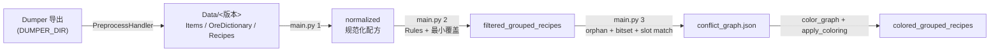

# GTNH-Recipe-Check · 配方冲突检查与催化组划分

面向 **GTNH**（GregTech: New Horizons）的配方自动化工具：以 GTNH Dumper 导出为输入，完成**配方清洗 → 等效合并 → 规则删减 → 催化组删减 → 冲突图着色**，最终产出一组在**发配方式 1**（每个催化组独立缓存、同时只跑一个配方）下互不「串配方」的催化组划分方案。

- 纯标准库实现，无第三方依赖，Python 3.9+。
- 内部判决一律以物品/流体的 `key` 为身份；`originalName` 只用于规则匹配，`translatedName` 只用于展示。

---

## 目录

- [目录结构](#目录结构)
- [快速开始：split 与 main 的分工](#快速开始split-与-main-的分工)
- [main.py 参数](#mainpy-参数)
- [config.py 参数](#configpy-参数)
- [数据流](#数据流)
- [输出产物](#输出产物)
- [机器专属规则（s3_rules/）](#机器专属规则rules)
- [术语定义](#术语定义)
- [方案流程](#方案流程)
- [常见问题](#常见问题)

---

## 目录结构

```text
GTNH-Recipe-Check/
├── main.py                 # 阶段编排入口
├── config.py               # 集中配置
├── s0_contracts/           # 阶段间共享契约、签名、标签、日志
│   └── DATA_CONTRACTS.md   # 跨阶段数据结构约定
├── s1_preprocess/          # 0. Raw -> Data 预处理（同步 Wiki Toolchain）
├── s2_normalize/           # 2. 输入组/催化组规范化
├── s3_rules/               # 3. 机器规则
├── s4_cover/               # 3. 最小催化集覆盖与关系分析
├── s5_conflict/            # 4. 无向冲突矩阵构建
├── s6_color/               # 5. 图染色搜索与最终催化组合并
├── s9_validation/          # 测试、实验与手工复核工具
├── Data/                   # 第一步产物
└── Output/<version>/                 # s2-s6 的阶段性产物
```

阶段对应关系：

| 前缀 | 阶段 | 主要职责 |
|---|---|---|
| `s0_contracts` | 公共契约 | 催化组、配方签名、标签、日志 |
| `s1_preprocess` | 1 | Dumper 原始数据整理为 Data；变换严格同步 Wiki Toolchain |
| `s2_normalize` | 2 | InputSlot/InputGroup、CatalystSet/CatalystGroup 规范化 |
| `s3_rules` | 3 | 按机器执行 Rules |
| `s4_cover` | 3 | 关系划分与最小催化集覆盖 |
| `s5_conflict` | 4 | 无向冲突矩阵构建 |
| `s6_color` | 5 | 图染色搜索 |
| `s9_validation` | 验证 | 测试、实验和历史复核工具 |

---

## 快速开始

第一步是一个完整处理器：`Raw -> Items -> OreDictionary -> Recipes -> Data`。三个子任务必须在同一处理器内按此顺序执行，因为配方关联依赖完整物品记录中的 `rawKey`/`nbt`。

```bash
python main.py --stage preprocess       # 第一步：Raw -> Data
python main.py --stage normalize        # 后续阶段
python main.py --stage all              # 从 Raw 开始完整执行
```

- 实现入口是 `s1_preprocess/handler.py`，`split.py` 只提供数据变换，不再作为独立 CLI 保留任务选择分支。
- 产物目录由 `config.DATA_SPLIT_DIR` 指定；换版本时修改 `DUMPER_DIR` 与 `DATA_SPLIT_DIR`。
- 第一步直接以 `GTNH-Chinese-Wiki-Toolchain/databaseDump/split_all.py` 为参考实现，保留本项目消费的数据变换，不保留 Wiki 页面、图片、tooltip 等展示层代码。

#### DUMPER_DIR 需要包含的文件

第一步处理器只读以下四项（均为 `DUMPER_DIR` 下的相对路径，由 GTNH Dumper 导出）：

| 路径 | 顶层结构 | 用途 |
|---|---|---|
| `advitempanel.json` | `{"shortKey": [ ... ]}` | 物品/流体注册表，生成 `Items.json`；同时用其 `rawKey`/`nbt` 做 NBT key 修正与退行 |
| `oreDictionary.json` | `{"oreDictionaries": [{"oreDict": 名称, "items": [key, ...]}, ...]}` | 矿辞典，生成 `OreDictionary.json` |
| `fluid.json` | `{"fluids": [{"gtDisplayKey": ..., "key": ...}, ...]}` | 把流体物品的 key 改写为真实流体 key |
| `recipes/` | 目录树，任意层级的 `*.json` | 每台机器一份配方（如 `recipes/gregtech/GTNEIDefaultHandler_assembler.json`），输出为 `Recipes/<相对路径>` |

- 各子步骤的必需输入：`advitempanel.json` → `items`，`oreDictionary.json` → `oredict`，`recipes/` → `recipes`；此外 `fluid.json` 供 `items` 改写流体 key，`recipes/` 也供 `items` 做 NBT 退行扫描（缺失时提示并跳过）。
- `recipes/` 下的目录名会被原样保留（`Recipes/<来源mod>/<处理器>.json`）；`main.py` 会自动扫描 `Recipes/` 下所有来源目录，只按 `INTERESTED_MACHINES` 匹配机器文件名，不再需要配置来源目录。
- `nbt_regress_cache.json`、`nbt_missing.csv`、`association_report.json`、`oredictionary_associations.json` 是 split 的**产物**（写在 `DATA_SPLIT_DIR`），不需要预先存在。

### 五阶段独立执行

```bash
python main.py --stage preprocess   # 第一步：Raw -> Data
python main.py --stage normalize    # s2：规范化输入/催化组合
python main.py --stage cover        # s3：Rules + 最小催化集覆盖
python main.py --stage conflict     # s4：冲突矩阵
python main.py --stage color        # s5：图染色
python main.py --stage all          # 从 Raw 开始完整执行
python main.py                      # 默认从 normalize 执行到 color
```

若 `Data/` 已存在，通常只运行：

```bash
python main.py
python -m unittest discover -s s9_validation -v
```

`s9_validation` 同时收纳回归测试、历史染色实验和手工冲突复核工具。

### 阶段数据约定

第二阶段起使用统一领域概念：

- `InputSlot`：槽内 OR；
- `InputGroup`：多个 InputSlot AND；
- `CatalystSet`：组内催化剂 AND，并带单个电路板和数量；
- `CatalystGroup`：多个 CatalystSet OR；
- 一条配方允许 0/1/多个催化组；
- `catalystChoices` 在规范化阶段展开为具体 CatalystSet，不再向下游传播；
- 所有物料数量 `amount` 在规范化、规则过滤和着色物化过程中保留。

第三阶段最小覆盖的对象是**独特 CatalystSet**。若一个催化集包含多个催化剂，则它可以覆盖同电路下由其全部子集构成的催化集。无催化条件在第三阶段实体化为特殊 `unconditional` 催化集，不再延迟到冲突图阶段创建虚拟节点。

第四阶段输出无向冲突矩阵；第五阶段对矩阵执行多轮随机化 DSATUR 和颜色容量扫描，最终颜色类合并为新的 `CatalystGroup`。

### 催化组覆盖关系、纯包含链与根组合并

对任意两个催化组，以其配方覆盖集合 `Recipes(A)` / `Recipes(B)` 定义五种规范关系：

| `relation` | 数学定义 |
|---|---|
| `equivalent` | `Recipes(A) == Recipes(B)` |
| `strict_subset` | `Recipes(A) ⊂ Recipes(B)` |
| `strict_superset` | `Recipes(A) ⊃ Recipes(B)` |
| `intersect` | 交集非空，但互不包含 |
| `disjoint` | 交集为空 |

正式输出：

- `Output/<version>/filtered_grouped_recipes/catalyst_relations.json`：原始组、等价类、五类关系和覆盖集合；
- `Output/<version>/filtered_grouped_recipes/catalyst_containments.md`：只沿 `strict_subset` 边枚举“最底层组 → 最顶层根组”的纯包含链，相交关系不参与；
- `Output/<version>/filtered_grouped_recipes/catalyst_reduction.json`：记录关系分量、顶层候选、纯包含链和最终最小覆盖。

不进行“共享催化剂根组强制合并”。组装机在 Rules 阶段按 `originalName` 模糊识别战利品（不区分大小写包含 `trophy`），移除“战利品 + 任意编程电路”的催化组；若配方所有催化组都被移除，则整条配方删除。

### 冲突图构建优化

正式链路在过滤与最小覆盖之后构建冲突图：

- **orphan 目标剪枝**：若目标配方的任一输入槽所有成员都是 orphan，则其它配方不可能提供该槽，目标不参与入边搜索；
- **bitset 候选召回**：为每个输入 key 预计算可提供它的配方 bitset，按目标槽求交，避免 O(R²) 全量两两比较；
- **输入组槽位匹配**：固定输入视为单成员槽，`inputGroups` 视为 OR 槽；候选源通过二分匹配确认不同目标槽不会争用同一个源组槽；
- **稀疏组间边**：内部使用边集合去重，最终再生成兼容着色的 `adjacency_matrix`；
- **0 组配方语义**：配方数据保持 `catalystGroups: []`；冲突分析层临时映射为虚拟无条件组，只用于冲突检测，不回写配方；orphan 无条件配方不会成为被触发目标。

输出：

- `Output/<version>/filtered_grouped_recipes/conflict_graph.json`
- `Output/<version>/filtered_grouped_recipes/empty_group_conflicts.json`

图中额外记录 `build_stats`：活动配方数、有效目标数、orphan 剪枝数、候选配方对、确认配方对、边数和自冲突数。

---

## main.py 参数

| 参数 | 说明 |
|---|---|
| `--stage <name>` | 单独执行 `preprocess` / `normalize` / `cover` / `conflict` / `color` / `all`。 |

不传 `--stage` 时执行 `normalize → cover → conflict → color`；`--stage all` 额外从 Raw 开始执行预处理。

---

## config.py 参数

| 配置项 | 说明 | 当前值 |
|---|---|---|
| `DUMPER_DIR` | GTNH Dumper 导出的原始数据目录，`s1_preprocess/split.py` 与 `s1_preprocess/handler.py` 的输入（需包含的文件见上节「DUMPER_DIR 需要包含的文件」） | `./Raw/2.9.0` |
| `DATA_SPLIT_DIR` | split 的输出目录，即数据集根目录 | `./Data/2.9.0` |
| `DATA_DIR` | `main.py` 读取的数据根目录，默认等于 `DATA_SPLIT_DIR` | `= DATA_SPLIT_DIR` |
| `INTERESTED_MACHINES` | 本次要处理的机器白名单（可填多台）。机器名 = 导出文件名去掉 `GTNEIDefaultHandler_` 前缀与 `.json` 后缀 | `{"alloyblastsmelter", "assembler", "fluidchemicaleactor", "largechemicalreactor", "laserengraver", "multimixer", "press"}` |
| `OUTPUT_ROOT` | 输出总目录 | `Output` |
| `OUTPUT_VERSION` | 输出版本名，默认取 `DATA_SPLIT_DIR.name` | `2.9.0` |
| `VERSIONED_OUTPUT_ROOT` | 按版本隔离的阶段产物根目录 | `Output/<version>` |
| `NORMALIZED_DIR` | 规范化阶段产物目录 | `Output/<version>/normalized` |
| `FILTERED_GROUPED_RECIPES_DIR` | 分组配方规则过滤 + 最小催化组覆盖产物目录 | `Output/<version>/filtered_grouped_recipes` |
| `CATALYST_RELATION_REPORT` | 催化组关系规范 JSON | `Output/<version>/filtered_grouped_recipes/catalyst_relations.json` |
| `CATALYST_CONTAINMENT_REPORT` | 纯包含链 Markdown 报告 | `Output/<version>/filtered_grouped_recipes/catalyst_containments.md` |
| `GROUPED_CONFLICT_FILE` | 分组链路冲突图 | `Output/<version>/filtered_grouped_recipes/conflict_graph.json` |
| `GROUPED_EMPTY_CONFLICT_FILE` | 分组链路空组冲突全量报告 | `Output/<version>/filtered_grouped_recipes/empty_group_conflicts.json` |
| `COLORED_GROUPED_RECIPES_DIR` | 正式链路最终着色目录 | `Output/<version>/colored_grouped_recipes` |
| `GROUPED_COLORING_FILE` | 正式链路着色汇总 | `Output/<version>/colored_grouped_recipes/coloring.json` |
| `GROUP_ORPHAN_MODE` | 孤儿标记偏好：`contains` / `only`（两种 flag 始终记录，不删除配方） | `contains` |
| `COLORING_ROUNDS` | 冲突图着色每个「单色类最大节点数」档位的随机探索轮数，越大越可能找到更优解 | `128` |
| `COLOR_CLASS_MAX_SIZE` | 单个颜色类允许的最大节点数；`None` 表示不限制 | `None` |
| `COLOR_CLASS_SIZE_SWEEP` | 是否按「单色类最大节点数」从小到大多档扫描（每档 `COLORING_ROUNDS` 轮）；各档统一目标函数比较，仍取全局最优 | `True` |
| `COLOR_CLASS_SIZE_SWEEP_MAX` | 逐 1 扫描的最大档位（从 2 起）；`None` 表示扫到 `COLOR_CLASS_MAX_SIZE` 或节点数 | `12` |
| `LOG_EMPTY_CONFLICT_CONSOLE` | 空催化组（编程电路0）与其它催化组的串配方单向检查是否在终端显示；`False` 时只在日志文件中记录 | `False` |

正式链路中，白名单机器若找不到配方文件会记录警告并跳过。

`:32767` 通配在 split 阶段按物品真实变体展开，并在 `association_report.json` / `oredictionary_associations.json` 中记录无候选项；`s2_normalize/ore_dictionary.py` 的 `EXPAND_WILDCARD_32767` 仅作为下游兜底开关。

---

## 数据流



---

## 输出产物

| 路径 | 内容 |
|---|---|
| `Output/<version>/recipe_check.log` | 统一运行日志：记录详细进度、警告、错误和异常堆栈 |
| `Output/<version>/normalized/manifest.json` | s2 上游输入、产物文件和聚合输出哈希 |
| `Output/<version>/normalized/machines/<machine>/recipes.json` | 规范化 Recipe 列表 |
| `Output/<version>/normalized/machines/<machine>/catalyst_sets.json` | 该机器使用的唯一 CatalystSet 注册表 |
| `Output/<version>/filtered_grouped_recipes/{machine}.json` | 分组配方经 Rules 过滤、催化组最小覆盖后的配方（保留 `inputGroups` 和规范 `catalystGroups`） |
| `Output/<version>/filtered_grouped_recipes/catalyst_reduction.json` | 分组链路的关系分量、等价组、顶层候选、精确集合覆盖统计与最优性标记 |
| `Output/<version>/filtered_grouped_recipes/catalyst_relations.json` | 催化组覆盖关系规范：原始组、等价类、五类关系与覆盖规模 |
| `Output/<version>/filtered_grouped_recipes/catalyst_containments.md` | 最底层等价类到最顶层根组的纯包含链清单 |
| `Output/<version>/filtered_grouped_recipes/conflict_graph.json` | 分组输入感知的冲突图；含稀疏边、邻接矩阵与 `build_stats` |
| `Output/<version>/filtered_grouped_recipes/empty_group_conflicts.json` | 空催化组单向冲突全量报告 |

---

## 机器专属规则（s3_rules/）

`s3_rules/*.py` 提供 `clean(recipes) -> recipes`，在 2 阶段、**催化组删减之前**执行，因此看到的是「等效合并后、尚未做子集拆分/抽象替换」的原始催化组列表。

已注册规则：

- `assembler.py`（组装机）：删除输入仅为 `Volumetric Flask` 的配方；按 `originalName` 模糊识别并移除“战利品 + 任意编程电路”的催化组；移除“远程请求器 + 编程电路18”的催化组；删除「催化组含编程电路 24 且输出物品全为 Cable」的配方。
- `fluidchemicaleactor.py`（化工厂）：把每个催化组的催化剂部分置空，只保留编程电路。
- `laserengraver.py`（激光蚀刻机）：删除若干特定输入/输出形状的配方。
- `press.py`（冲压机床）：删除输出物品全部为 `Extruder Shape`（模头）或全部为 `Mold`（模具）的复制型配方；删除普通输入中含 `originalName` 严格为 `Dough`（面团）的配方。

新增机器规则：在 `s3_rules/` 下新建 `<机器>.py` 实现 `clean`，并在 `s3_rules/registry.py` 的 `_MACHINE_CLEANERS` 中注册。未注册的机器使用默认 cleaner（原样返回）。

---

## 术语定义

### 输入与输出
- **输入**：由 `[物品, 数量]` 列表和 `[流体, 数量]` 列表共同构成。
- **输出**：同样由 `[物品, 数量]` 列表和 `[流体, 数量]` 列表共同构成。
- 输入和输出均不能为空。

### 催化组
- **催化组**：由 `催化剂` 列表和 `编程电路` 两部分组成。
- 催化剂列表可以为空，编程电路可以为空，二者可以同时为空。

### 配方
- **配方**：`输入 + 催化组 -> 输出`。
- 每个配方中的催化组中，编程电路数量不超过 1，催化剂种类不限。

### 等效配方
- **等效配方**：`输入` 和 `输出` 在种类和数量上完全相同的 N（N>0）个配方（催化组可不同）。

### 组内配方
- **组内配方**：在给定催化组 $G$ 的条件下能够被触发的全部等效配方的并集。
- 若 $G$ 包含多个催化剂，需考虑 $G$ 的**任意非空子集**作为实际起作用的催化条件，取并集：

$$ Recipes(G) = \bigcup_{\emptyset \neq S \subseteq G} Recipes(S) $$

### 串配方
- **串配方**：给定催化组 $G$ 及其缓存空间，若缓存空间中的物品、流体能够同时满足两个非等效配方的触发条件，则称这两个配方在该催化组下构成串配方。
- 典型场景：
  1. 某个配方需要消耗另一个配方所需的催化剂，导致催化剂被反应掉；
  2. 缓存空间内存在的同一输入被多个可能的催化组反应为不同输出；
  3. 缓存空间内存在的不同输入被多个可能的催化组反应为不同输出。

### 发配方式
- **方式 1**：每个催化组使用独立缓存空间，同一空间内同一时间只允许存在一个配方。
- **方式 2**：每个催化组独立缓存，同时进行全部组内配方发配，但流体种类数受限。
- **方式 3**：多个催化组共用流体缓存、物品缓存独立；每组独立发配，同一时间各自只存在一个配方，流体种类数受限。

本项目只针对**方式 1**。

---

## 方案流程

### 0. 数据准备（s1_preprocess）
把 Dumper 导出整理为 `Data/<版本>/`：`Items.json`（`key`/`originalName`/`translatedName`）、`OreDictionary.json`（`{矿辞典名: [key...]}`）、`Recipes/<来源>/GTNEIDefaultHandler_<机器>.json`。第一步严格同步 Wiki Toolchain 的数据变换：物品/流体 key 归一化、`nbt_regress_cache`、`nbt_identity` NBT 关联、`:32767` 通配展开、矿辞通配校验和 `otherItems` 角色归类。

### 1. 规范化

- 只处理 `INTERESTED_MACHINES` 白名单内的机器；已有分组产物在对应阶段复用。
- **输入可选列表展开**：`inputItems`/`outputItems` 中同一项的多个可选对象按笛卡尔积展开为多条配方。
- **附加槽位归类**：`s1_preprocess/recipe_roles.py` 把熔炉/高炉/燃料/作物基因提取器等已知 `otherItems` 归入输入或输出，保留候选顺序、概率和不消耗标记。
- **拆分催化条件**：带 `nc` 标记的输入项按是否为编程电路，分别归入催化组的 `circuit` / `catalysts`。
- **矿辞典与通配展开**（`s2_normalize/ore_dictionary.py`）：
  - `#矿辞典名` → 查 `OreDictionary.json` 展开为全部成员；
  - `:32767` 结尾的通配 meta → split 阶段已按物品真实变体（含 NBT 变体）展开为具体 `key`；无候选项写入 `association_report.json` / `oredictionary_associations.json`。
  - **同名折叠**：若一次展开得到的多个 `key` 其 `(originalName, translatedName)` 完全相同，则折叠为**单个虚拟 key**（`s2_normalize/virtual_key.py`），展开退化为「key 替换」，不产生多份等价配方。
- **等效合并**：输入（物品+流体）与输出（物品+流体）完全相同的配方合并，其催化组合并去重。
- **翻译**：为物品/流体补充 `originalName` / `translatedName`，**保留 `key` 作为唯一身份键**（映射失败记入日志）。

### 2. 删减

- **规则删减（有损，需人工确认）**：按 `s3_rules/*.py` 删除部分配方；删减后的集合即视为新的「全配方」，不再覆盖被删除的配方。
- **催化组删减（自动、无损）**：对全配方中出现的所有催化组 $G$ 计算 $Recipes(G)$，定义关系：
  - **包含**：$Recipes(A) \supseteq Recipes(B)$；
  - **等价**：$Recipes(A) = Recipes(B)$；
  - **相交**：交集非空且既非包含也非等价。
  将存在上述关系的催化组归入同一**关系分量**；对每个分量先归并覆盖集合相同的**等价类**（用**抽象催化剂**取代，并在 `catalyst_reduction.json` 记录还原信息），再剔除被严格包含的支配候选，最后对剩余顶层候选做**精确最小集合覆盖**（分支定界；贪心只用于提供上界）。输出元数据中的 `set_cover.optimal` 表示该次覆盖是否已证明最优。

> 多催化剂催化组是一个完整触发集合：例如 `A+B` 组会覆盖只要求 `A`、只要求 `B` 或同时要求 `A+B` 的配方子集，但不会覆盖空催化组。
>
> 最小覆盖的解可能不唯一；程序在最少组数下使用稳定排序打破并列。

### 3. 冲突图与着色

1. **构建冲突图**（`build_conflict_graph`）：
   - 节点 = 候选催化组（按 `group_signature` 去重）；边 = 会被同一缓存同时触发、且构成串配方的两组。
   - **方向判定**：对两个配方分别检查 `左→右`、`右→左`。以 `key` 为身份、忽略数量：
     `左→右 ⇔ 右配方的全部输入槽可由左配方输入槽匹配`。
   - **输入组槽位匹配**：固定输入是单成员槽，`inputGroups` 是 OR 槽；每个目标槽必须匹配不同的源槽，避免两个目标槽同时消费同一个源组槽。
   - **orphan 目标剪枝**：目标配方任一输入槽全部为 orphan 输入时，其它配方不可能提供该槽，直接跳过该目标。
   - **bitset 候选召回**：按输入 key 预计算可提供该 key 的配方 bitset，对目标槽求交得到候选源，最后再做精确槽位匹配。
   - **输出相等豁免**：若两配方输出（物品+流体，忽略数量）**完全相同**，则即使输入构成包含也视为良性连带，不判为串配方（不记自冲突、不连边）。
   - **自冲突**：落在同一催化组内、且构成串配方的非等效配方对，记入日志（无法靠分组解决）。
   - **0 组/无条件配方单向全量检查**：分析层只统计「其它组配方 → 无条件配方」方向；orphan 无条件配方不会成为被触发目标。全量报告写入 `Output/<version>/filtered_grouped_recipes/empty_group_conflicts.json`，`conflict_graph.json` 的 `empty_group_conflict_counts` 只保留计数。
2. **着色**（`color_graph` + `apply_coloring`）：
   - 相邻节点必须不同色（即冲突的催化组不能共处同一缓存）；
   - 同色节点合并为一个新催化组；
   - 目标：**催化组数（颜色数）最少**；并列时，把各催化组覆盖的配方数**从大到小**排成列表逐位比较，先更大者更差（即先最小化最大组，再最小化第二大组，依此类推）。`coloring.json` 的 `recipe_class_sizes` 记录了该降序列表。
   - 探索方式：选点按 DSATUR（饱和度、度数，随机打破平局）；取色以最小可用色为主，并按概率随机偏离去，解决「各轮目标值完全相同」的探索性不足（`s6_color/graph_coloring.py` 的 `_COLOR_EXPLORE_PROB` / `_MAX_COLOR_CHOICES`）。
   - **档位扫描**：把「单色类最大节点数」从 2 逐 1 放宽到 `COLOR_CLASS_SIZE_SWEEP_MAX`（再追加不限制档）逐档探索，每档 `COLORING_ROUNDS` 轮。限制节点数只是搜索期的启发式约束，**不改变目标函数**：受限档位同样是合法着色，因此各档候选（含不限制档）统一比较，最终仍取全局最优。实测限制节点数能显著改善“各组配方数降序”这一目标（`multimixer` / `fluidchemicaleactor` / `laserengraver` 等）。
   - 多轮随机探索后**只保留并输出最优一轮**（`coloring.json` 中的 `best_round` 记录其轮号）。
   - **跨次运行也只保留最优**：`graph_fingerprint` 一致（冲突图未变）且历史方案不差时，沿用历史结果并重新套用到当前配方。
   - 合并后的催化组可含多个编程电路，标签展示时按编号升序，无编号的「编程电路0」排最前。
   - **输出组间排序**（`group_output_order_key`）：`colored_grouped_recipes/{machine}.json` 中每条配方的催化组、`coloring.json` 与终端列出的各组，均按「组内最小编号升序」排列；无编程电路的组排最后；完全空组（无条件反应）视作「编程电路0」排最前。

---

## 常见问题

- **改了 `s3_rules/` 但结果没变**：正式链路会重新计算。
- **只想更新部分机器**：把目标机器放入白名单即可，未列入的机器旧产物不受影响。
- **想新增某台机器的删减规则**：在 `s3_rules/<机器>.py` 实现 `clean` 并到 `s3_rules/registry.py` 注册。
- **展示/日志乱码（Windows）**：控制台重定向可能因 GBK 无法输出中文与特殊符号，可改用 `python -X utf8 ...` 或先执行 `chcp 65001`。
